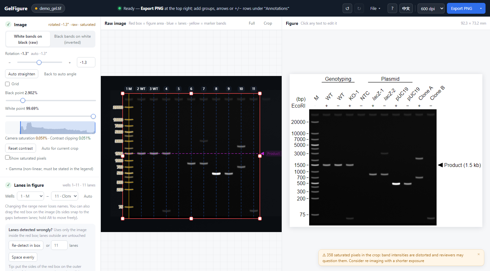
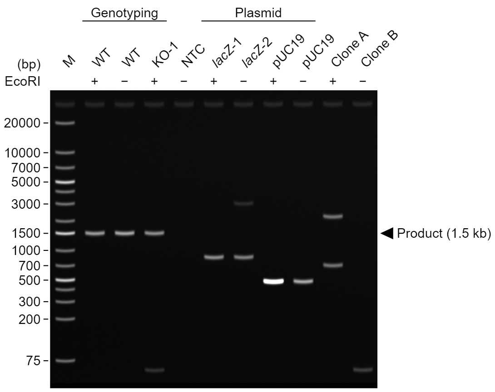

<div align="center">

# GelFigure

**Turn a raw DNA or protein gel image into a publication-ready figure — in your browser, offline.**

[**Download the single HTML file**](https://github.com/poplarity/GelFigure/releases/download/v0.6.5/GelFigure-v0.6.5.html) · [Use online](https://poplarity.github.io/GelFigure/) · [中文说明](README.zh-CN.md)

[](https://github.com/poplarity/GelFigure/actions/workflows/ci.yml)
[](LICENSE)


</div>

## Quick start

**Download one file, open it in your browser, and start making your figure. No installation, ZIP extraction or GitHub account is needed.**

1. **[Download GelFigure-v0.6.5.html](https://github.com/poplarity/GelFigure/releases/download/v0.6.5/GelFigure-v0.6.5.html)** (about 380 KB). Save it to your Desktop or Downloads folder.
2. **Double-click the downloaded file.** It opens in your browser. If a text editor opens instead, right-click → **Open with** → Firefox, Chrome, Edge or Safari.
3. **Click “Choose file” and select your gel image.** Check the detected gel type, lanes and marker, click the lane names to edit them, then choose **Export PNG**.

That one HTML file is the complete tool, including its layout and image-processing code. Keep it on your computer or send the same file to a colleague. Once downloaded, it works without an internet connection.

**Get the right file:** choose the release attachment named **GelFigure-v0.6.5.html**, not the repository's **index.html**, **Source code (zip)** or **Source code (tar.gz)**. You do not need **Code → Download ZIP**. If you reach the [release page](https://github.com/poplarity/GelFigure/releases/latest), expand **Assets** and click the file ending in **.html**.

**Keep your work:** use **File → Save project** before closing. On a phone it is under **⋯** (or **Export → Save project**). Your **.gelfig** file contains the original image and annotations; reopen it in GelFigure to continue.

**Prefer the website?** [Open GelFigure online](https://poplarity.github.io/GelFigure/). On phones and tablets, use this link in your browser; an HTML attachment preview in a messaging app may not run the tool.

Need help? See [the illustrated download and opening guide](docs/getting-started.md) or press **?** inside the app.



Drop in the image from your gel imager or scanner. GelFigure works out whether it is a DNA (agarose) or a protein (SDS-PAGE) gel, straightens and crops it, finds the lanes, identifies the ladder and labels its band sizes in bp or kDa. You type the lane names on the figure and export. Everything happens in the browser; **nothing is uploaded, nothing is installed**.

<p align="center"></p>

## Contents

- [Features](#features)
- [Quick start](#quick-start)
- [Versions](#versions)
- [Privacy](#privacy)
- [Supported input](#supported-input)
- [What is detected automatically](#what-is-detected-automatically)
- [Exports](#exports)
- [Image integrity](#image-integrity)
- [Built-in ladders](#built-in-ladders)
- [Browser support](#browser-support)
- [Known limitations](#known-limitations)
- [Development](#development)
- [Contributing](#contributing) · [Citing](#citing) · [Acknowledgements](#acknowledgements) · [License](#license)

## Features

- **Fully automatic first draft**: straightening (±15°), crop, lane detection, ladder identification and size labels, linear contrast.
- **DNA and protein gels**: the gel type is recognised on import (colour, band width, band count, migration curve) and the matching mode opens — ladder library, tolerances and units (bp / kDa). A switch at the top of the Image panel overrides the guess without losing names, groups or arrows.
- **Edit on the figure itself**: click a lane name and type, Enter jumps to the next lane; drag across lane names to draw a group line; click cells to cycle `+` / `−`. IME-safe for Chinese, Japanese and Korean input.
- **Lanes numbered by well**: cropping only selects which wells are shown, so names, markers and groups are never lost when you change the crop.
- **Annotations papers use**: group lines, `+`/`−` rows, region boxes (optionally enlarged beside the figure), side brackets for smears or (Ub)n, side text for the stain or antibody, and `*` / `#` / `†` marks for non-specific bands or other products.
- **Labels that never collide**: group labels too wide for their line wrap (or shrink, or stay on one line — your choice) and otherwise move up a row; Shift+Enter breaks a label by hand; any label, arrow or box can have its own font size.
- **Target-band arrows with sizes**: click a band; the arrow snaps to it and its size is estimated from the marker(s). Sizes outside the ladder, or where two markers disagree by more than 10 %, are marked `≈`.
- **Several exposures at once**: drop all exposures of one gel; the best one (least saturation, best signal-to-noise) is chosen, and you can switch with all annotations kept.
- **Rotation keeps annotations in place**: lanes, bands, arrows and the crop box rotate with the image.
- **Lane removal with splice marks**: select a lane and press `H`; a splice gap or line is added and recorded. Empty lanes are suggested for removal (never removed silently). `Delete` / `⌫` deletes a wrongly detected lane.
- **Lane lines in two clicks**: if detection is off, drag the leftmost and rightmost lane lines onto their lanes and enter the lane count — the lanes in between are spaced evenly.
- **Pre-flight check before export**: camera saturation, contrast clipping, effective resolution below 300 dpi, tiny fonts, extrapolated sizes, with one-click fixes.
- **Reproducible**: project files (`.gelfig`) contain the original image and every setting; reusable style templates; an autosaved draft survives a page reload.
- **Works on a phone**: a bottom bar switches between Image, Figure and Settings; **Export** offers every format and resolution. Pinch to zoom the image, tap a lane to nudge, cut or delete it, double-tap to add one. An exported PNG opens as a picture you long-press to save to Photos (this also works inside WeChat, which cannot download files) or send through the share sheet.
- **Bilingual interface**: English and Chinese, switchable at any time. Figures are always in English.

## Versions

The current version is **0.6.5**. The 0.6 series adds protein gels, annotations, and mobile support. 0.6.3 ships a single-file offline build (`GelFigure-<tag>.html`) for double-click use; 0.6.4 reworks the phone layout (bottom bar, export sheet with every format, long-press to save, touch editing); 0.6.5 keeps group labels from overlapping (wrap / shrink / one line), adds typed line breaks and a font size per label. Earlier versions are kept as tags and branches if you need to go back: `v0.6.4` ([`release/0.6.4`](https://github.com/poplarity/GelFigure/tree/release/0.6.4)), `v0.6.3`, `v0.6.2`, `v0.6.1`, `v0.6.0` and `v0.5.0`.

## Privacy

GelFigure is a static web page with no backend. Images are decoded and processed by JavaScript in your browser, and results are saved by your browser's own download mechanism.

The page carries a [Content Security Policy](index.html) that **forbids it from connecting to any other server** (it may only load its own files), so this is enforced by the browser, not just promised. The only data kept on your computer are preferences, custom ladders and the autosaved draft in the browser's local storage.

## Supported input

| Format | Notes |
|---|---|
| TIFF (8 / 16 / 32-bit grayscale) | Recommended. Uncompressed, LZW, Deflate and PackBits; little- and big-endian. Works with the TIFFs gel imagers and flatbed scanners export. |
| PNG / JPG / BMP | Read as 8-bit by the browser; a warning suggests using the raw 16-bit TIFF instead. |
| `.gelfig` | GelFigure project file. |

Both bright-bands-on-dark (EtBr, SYBR, fluorescence) and dark-bands-on-light (Coomassie, scanned films) images are handled. One **Invert** checkbox swaps black and white, and the panel always says what the figure currently looks like.

## What is detected automatically

| Step | How |
|---|---|
| Straightening | Searches ±15° for the angle that makes wells and bands horizontal. Larger angles can be set by hand (±45°), with a reference grid. Perspective (keystone) distortion is not corrected. |
| Crop | The gel slab is found from the well row and the band region; the default crop includes the wells. |
| Lanes | Combines band signal, the gel slab edges and the shape of the wells (template matching), so edges are not mistaken for lanes and empty wells are still found. Where lanes run together (crowded protein gels), the top of the gel, where samples have not spread yet, corrects the spacing. If detection is still wrong, place the two end lanes and space the rest evenly, or re-detect inside the red box only. |
| Gel type | DNA or protein, from the image itself: blue-dominant colour (Coomassie) and broad bands point to protein, thin bands and many evenly spaced ladder bands to DNA, and the curvature of the migration curve votes too. The reasons are shown under the switch. Protein bands are detected with wider smoothing and tolerances; prestained markers are accepted from 4 bands up. |
| Marker lanes | Lanes that a ladder explains completely — not simply the lanes with the most bands, which on a protein gel are the lysates. Several markers on one gel share one migration curve and are matched jointly against the built-in ladders of the gel type (favourites are preferred). |
| Band sizes | Robust fit (RANSAC + polynomial) with order-preserving assignment; dragging one band re-fits the others around it. |

## Exports

| Export | Content |
|---|---|
| PNG | Rendered at the chosen dpi (300 / 600 / 1200). Includes `pHYs` (resolution), `sRGB` and an embedded processing summary (`iTXt`, UTF-8). |
| TIFF | 8-bit grayscale, LZW, with resolution tags and the processing summary. For journals that accept only TIFF. |
| SVG | Vector text and lines; edit in Illustrator or Inkscape. |
| Uncropped image | Same rotation and contrast as the figure, with the crop box, well numbers and removed lanes marked. For the supplementary information. |
| Original data | The untouched source file, byte-identical, with its SHA-256 in the file name. |
| Processing log (JSON) | Source SHA-256, rotation, linear levels, saturation and clipping statistics, effective resolution, removed lanes and why, ladder fit scores, how each arrow size was estimated. |

The **Layout** section shows the **effective resolution** of the gel itself (gel pixels ÷ printed width). If it is below 300 dpi, GelFigure tells you the largest width that keeps 300 dpi and offers to apply it. Total figure width can be set directly to a journal column (85 / 120 / 180 mm).

## Image integrity

GelFigure follows common journal image policies (e.g. Nature, PLOS, JBC; see Rossner & Yamada, *J Cell Biol* 2004, "What's in a picture?"):

- Only **linear, whole-image** adjustments. Gamma is locked at 1 unless explicitly unlocked, and is then reported in the legend notes.
- **Camera saturation** (the raw data is already clipped, so you need to re-image) is reported separately from **contrast clipping** (caused by the display settings and fixable).
- Removed lanes get a visible **splice gap or line**, and suggested legend text is generated. Never splice lanes from different gels into one panel.
- Every export carries a processing summary; the uncropped image and the original file can be exported for the supplement.

GelFigure helps you comply, but **you remain responsible** for following your journal's policy.

## Built-in ladders

**DNA ladders** (23): Thermo Scientific GeneRuler: 1 kb, 1 kb Plus, 100 bp, 100 bp Plus, 50 bp, DNA Ladder Mix, Low Range, Ultra Low Range, Express · NEB: 1 kb, 100 bp, 1 kb Plus · Takara: DL2000, DL5000, DL15000 · TransGen: Trans2K, Trans2K Plus, Trans2K Plus II, Trans5K, Trans15K · Tiangen: Marker D2000 · Yeasen: GoldBand 1 kb, GoldBand 100 bp Plus.

[`docs/ladders.md`](docs/ladders.md) lists each one with its catalogue number, band count and reference bands — and the few whose band sizes are identical, which no algorithm can tell apart (mark the one you use as a favourite).

**Protein ladders** (41, kDa, apparent molecular weights): Bio-Rad Precision Plus (Dual Color, All Blue, Kaleidoscope, Unstained, Dual Xtra) · Thermo / Invitrogen (PageRuler, PageRuler Plus, Unstained, Spectra Multicolor, Novex Sharp, SeeBlue Plus2) · NEB · Abcam · GenScript · Yeasen · Epizyme · Beyotime · TransGen · Solarbio · Sangon. Prestained sizes are calibrated in a Tris-glycine system and shift with gel percentage and buffer, so a size read from one is an estimate; the pre-flight check reminds you to write "apparent molecular weight" in the legend.

Any other ladder can be added under **Marker → Custom ladder**; custom ladders travel inside style and project files. To add a ladder for everyone, see [CONTRIBUTING.md](CONTRIBUTING.md).

## Browser support

Current Chrome, Edge, Firefox and Safari 16.4+ on Windows, macOS and Linux. The test suite runs in Chromium, Firefox and WebKit on every change.

When the downloaded HTML is opened directly from disk, some browsers disable IndexedDB for local files; everything works except the autosaved draft. Use the online version or "Save project" if you need it.

## Known limitations

If the page looks like plain text and unstyled buttons, its stylesheet has not loaded or page styles have been disabled. Reload with Ctrl+Shift+R (Command+Shift+R on macOS). For offline use, download the **single-file HTML** from [Releases](https://github.com/poplarity/GelFigure/releases/latest), or extract the **whole ZIP** and keep `css/` and `js/` beside `index.html`; the repository's `index.html` alone is not a standalone app.

If browser storage is blocked or full, the app can still edit and export. Preferences and custom ladders stay in the current tab only; use **Save project** before closing. Automatic draft recovery also depends on the browser allowing IndexedDB.

- Automatic detection has been validated on DNA agarose gels, Coomassie-stained SDS-PAGE gels and synthetic gels. On a crowded protein gel whose lanes touch, lane detection can merge neighbours — set the lane count under **Lanes in figure** and the rest follows. If detection fails on your images, please [open an issue](https://github.com/poplarity/GelFigure/issues/new/choose).
- Band quantification (densitometry) is not supported.
- Bio-Rad `.scn` / `.1sc` and other proprietary formats must be exported to TIFF first. BigTIFF and palette TIFFs are not supported.
- 16-bit PNGs are read as 8-bit by browsers.

## Development

This section is for contributors editing the source. To use GelFigure, follow the single-file download steps above. Source checkouts keep `css/` and `js/` beside `index.html`; those files must stay together.

No build step and no dependencies: the app is plain HTML, CSS and JavaScript loaded with ordinary `<script>` tags, so it also runs from `file://`.

```
index.html          the page
css/style.css       styles
js/storage.js       optional preferences with in-memory fallback
js/i18n.js          interface language (L('中文', 'English') pairs)
js/tiff.js          TIFF decoder            js/engine.js    image analysis
js/ladders.js       ladder library          js/render.js    figure layout (SVG)
js/export.js        PNG / TIFF / SVG / logs js/app.js       state, pipeline, undo, projects
js/editor.js        raw-image canvas        js/ui.js        side panel and top bar
js/figedit.js       editing on the figure   js/demo.js      synthetic test gel
js/uitest.js        interaction self-test   test/test.html  engine self-test
tests/run.mjs       runs both self-tests in Chromium, Firefox and WebKit
```

Run the tests:

```bash
npm install
npx playwright install chromium firefox webkit
npm test                      # all three engines
npm test -- --browser=chromium
```

Or open `test/test.html` (`"allOk": true`) and `index.html?demo=1&uitest=1` in a browser.

## Contributing

Bug reports, gel images that break detection (only if you are allowed to share them), new ladders, translations and code are welcome. See [CONTRIBUTING.md](CONTRIBUTING.md).

## Citing

If GelFigure helped with a publication, please cite it; see [CITATION.cff](CITATION.cff) or use GitHub's "Cite this repository" button.

## Acknowledgements

GelFigure is designed and developed by [poplarity](https://github.com/poplarity).

Development is supported by API tokens provided by **Zhao Bowen** ([@zhober](https://github.com/zhober)).

## License

[MIT](LICENSE)
