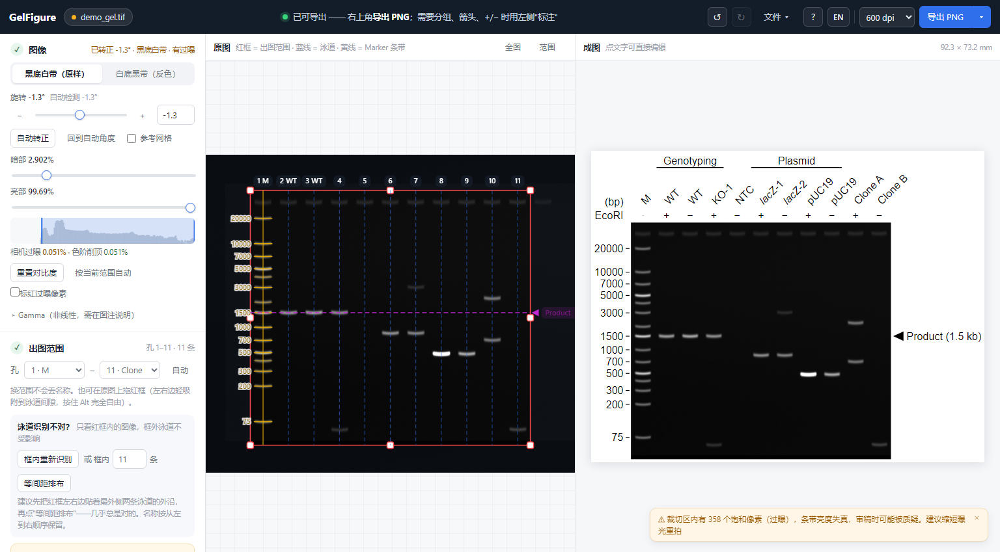

<div align="center">

# GelFigure

**把原始 DNA 胶或蛋白胶图一键做成可投稿的成图 —— 在浏览器里完成，离线可用。**

[**下载单文件 HTML**](https://github.com/poplarity/GelFigure/releases/download/v0.6.14/GelFigure-v0.6.14.html) · [在线使用](https://poplarity.github.io/GelFigure/) · [English](README.md)

[](https://github.com/poplarity/GelFigure/actions/workflows/ci.yml)
[](LICENSE)


</div>

## 快速开始

**只需下载一个文件，用浏览器打开就能做图。不用安装、不用解压，也不用注册 GitHub。**

1. **[点击下载 GelFigure-v0.6.14.html](https://github.com/poplarity/GelFigure/releases/download/v0.6.14/GelFigure-v0.6.14.html)**，不到 1 MB，保存到桌面或“下载”文件夹。
2. **双击刚下载的文件。** 它会在浏览器中打开；如果打开的是记事本等软件，右键文件 → **打开方式** → 选择 Firefox、Chrome、Edge 或 Safari。
3. **点“选择文件”，导入你的胶图。** 核对识别出的胶种、泳道和 Marker，点泳道名填写名称，再点 **导出 PNG**。

这一个 HTML 文件已经包含完整界面和处理功能。保存后可以断网使用，也可以把同一个文件直接发给同事。

**认准文件名：** 下载的是 **GelFigure-v0.6.14.html**，不是仓库里的 **index.html**，也不是 **Source code (zip)** 或 **Source code (tar.gz)**。不需要点 **Code → Download ZIP**。如果进入了[版本下载页](https://github.com/poplarity/GelFigure/releases/latest)，展开 **Assets（附件）**，只点结尾为 **.html** 的文件即可。

**下次接着做：** 关闭前点 **文件 → 保存项目**；手机端在右上角 **⋯** 里（或 **导出 → 保存项目**）。得到的 **.gelfig** 项目文件会保存原图和标注，下次用 GelFigure 打开即可继续。

**也可在线使用：** [打开 GelFigure 网页版](https://poplarity.github.io/GelFigure/)。手机、平板优先在浏览器中打开此链接；微信等软件里的 HTML 附件预览不一定能运行工具。

详细步骤见[下载与打开图解](docs/getting-started.zh-CN.md)，工具内点 **?** 也可查看帮助。



把成像仪或扫描仪导出的图拖进去，GelFigure 会自动判断是 DNA（琼脂糖）胶还是蛋白（SDS-PAGE）胶，转正、裁切、识别泳道、识别 Marker 型号，并按 bp 或 kDa 标出条带大小。你只需要在成图上填泳道名，然后导出。所有处理都在浏览器里完成，**胶图不上传、不安装**。

<p align="center"></p>

## 目录

- [功能](#功能)
- [快速开始](#快速开始)
- [版本](#版本)
- [隐私](#隐私)
- [支持的输入](#支持的输入)
- [自动识别了什么](#自动识别了什么)
- [导出](#导出)
- [图像规范](#图像规范)
- [内置 Ladder](#内置-ladder)
- [浏览器支持](#浏览器支持)
- [已知局限](#已知局限)
- [开发](#开发)
- [参与贡献](#参与贡献) · [引用](#引用) · [致谢](#致谢) · [许可证](#许可证)

## 功能

**版式常驻展示与更新日志。** “版式”与其他左侧设置同级，默认展开；手机在“设置”页。新版本首次打开会出现简短更新卡片，不打断操作，导入图片后自动收起。在开始页、**文件**、**使用说明**或手机 **⋯** 中点 **更新日志**，可随时查看历次版本的中英文要点和当前运行版本。日志离线可读；记住已看版本需浏览器允许存储，清理数据或更换浏览器／离线文件后可能再次提示。开发版有明确标识。

**红色标注。** 点箭头／符号、区域框、侧边括号或侧边文字，选择 **颜色 → 红色**；方框的标签及放大框同步变红。分组文字连同横线一起改色，条件名控制整行颜色。点泳道名可选中部分文字标红，未选中则作用于整个名称；点 Marker 数字可标红一个大小或这组 Marker 的标签、刻度和单位。选“默认”可恢复原色，深色胶图上的默认方框仍为白色。颜色随项目、历史和适用的样式字段保存，PNG、TIFF、SVG、可编辑 PPT 均保留；灰度胶图含红色标注时自动导出 RGB TIFF，不改变原始像素或识别结果。

**反馈和支持随时可打开。** 电脑顶栏 **反馈 / 支持**、手机 **⋯ → 反馈 / 支持作者 / Star** 都有固定入口，无需先导入或导出图片；导出提示关闭后，下次导出仍会出现。网页版可直接填写反馈，无需 GitHub 账号，FormSubmit 会将填写的内容、可选回复邮箱和工具版本转发给作者。失败会保留草稿。离线 HTML 可填写、复制，再到网页版发送。支付宝赞助与 GitHub Star 均自愿；同时修复隐藏 Marker 标签后箭头旁多留空列的问题。

**单个泳道与局部文字格式。** 默认继续统一设置泳道名。点名称，展开 **此泳道单独设置**，按需启用自定义字号和角度；取消勾选即可恢复统一设置。选中文字后可设正体、斜体、上标、下标，未选中则作用于整个名称；“清除格式”可恢复统一字形。格式随项目、样式保存，导出 PPT 后仍可编辑。成功导出后可在工具内留下反馈，或用作者提供的支付宝码自愿赞助；查看、保存收款码不替换已导出的胶图，也不会自动打开支付。

**泳道名角度与顶部布局。** 较窄电脑窗口的导出按钮也保持在右上角。成图上方的 **泳道名角度** 可选预设，或滑动、输入 0–90° 整数角度。**自动（默认）** 沿用原有间距判断，随时选回即可恢复自动排版；角度随项目、样式保存，并用于各格式导出。

**更直接的泳道和 Marker 操作。** 出图范围直接拖红框；泳道数量和“框内重新识别泳道和 Marker”放在左侧（手机在“设置”页）。拖 ↔ 首尾线实时等距，拖中间线整体平移。重新识别一次完成两个步骤，保留手动确认的 Marker、定位点及取消 Marker 的选择；单纯裁切不会重新分类。名称、批量粘贴和字体字号集中在成图一侧。选定 Marker 泳道和型号后，点“识别此泳道”只对齐这一道。小型参考卡留在原图旁，可预览型号、选大小后点实际条带定位。直接点成图上的 Marker 数字即可改字号、显示/隐藏或删除；隐藏保留校准，删除同时移除定位点。未匹配到实际条带的预测标注默认隐藏，识别结果仍需对照原图核对。旧项目的已有位置保持不变，修改可撤销。

**历史项目。** 顶栏、文件菜单或手机右上角 **⋯ → 历史项目** 可打开本浏览器缓存的胶图。导入下一张图会保留上一张的进度；可改名、删除，恢复时保留裁切、标注、字体、颜色及全部曝光，不重新识别。旧版草稿自动迁移。缓存失败时会提示；缓存属于当前浏览器，清理浏览器数据、换浏览器或换电脑后不能直接访问。请另存 `.gelfig` 备份当前曝光的原图和标注，多曝光的其他原文件也请保留。

**本机 Marker 库。** 手动添加或从项目、模板导入的自定义型号，连同常用收藏一起缓存，不依赖当前胶图。同一浏览器重新打开同一网址或文件，会先恢复型号再识别图片；旧数据自动迁移，Marker 区会显示实际保存状态，一种存储失效时尝试备用缓存。换电脑、浏览器或新版离线 HTML，可用 **备份 Marker 库 / 导入 Marker 库** 迁移；导入会合并型号并保留原有定义，备份不含胶图。清理浏览器数据或结束无痕浏览仍可能清除缓存，建议保留这个很小的 JSON 备份。

- **全自动出初稿**：转正（±15°）、裁切、泳道识别、Ladder 型号识别与条带大小标注、线性对比度。
- **DNA 胶和蛋白胶**：导入时自动判断胶种（颜色、条带宽度、条带数、迁移曲线），打开对应的模式——Ladder 库、匹配容差和单位（bp / kDa）一起切换。判断错了可在"图像"面板顶部一键切换，泳道名、分组和箭头都不会丢。
- **直接在成图上编辑**：点泳道名就能输入，回车跳到下一条；从一个泳道名拖到另一个画分组横线；点格子切换 `+` / `−`。中文输入法选字时的回车不会误跳。
- **泳道按加样孔编号**：裁切只是选择显示哪几孔，改裁切不会丢名称、Marker 和分组。
- **论文常用的标注**：分组横线、`+`/`−` 条件行、区域框（可在成图旁放大展示）、侧边括号（拖尾、(Ub)n）、侧边文字（染色方法、抗体），以及非特异条带等的 `*` / `#` / `†` 标记。
- **标注文字不再相撞**：分组文字比横线宽时自动换行（也可选缩小字号或保持一行），仍放不下就错开到上一行；Shift+Enter 手动换行；每条标注、箭头、框都能单独设字号。
- **系统字体选择**：在成图上方「字体与字号」选择 Arial、新罗马（Times New Roman）、Helvetica、Calibri 或 Cambria；文字测量、换行、PNG/TIFF/SVG/PPTX 导出及项目、样式存档同步使用所选字体。不下载或内嵌字体文件；设备缺少所选字体时会使用替代字体，SVG/PPTX 在其他电脑打开时也一样。
- **紧凑的 Marker 单位标题**：bp/kb/kDa 位于胶图侧边上沿稍下方，不再随着条件行增多而上移；条件表保持原来的间距，只在文字会相撞时补充必要空间。
- **默认灰度，可切换保留原色**：新导入的图片默认以灰度处理；染色蛋白胶和彩色 Marker 可在「图像」中选择「保留原色」。切换仅改变显示，不重新识别或移动标注；已保存项目恢复其原有显示模式。原色模式保留旋转、裁切，不套用灰度的对比度、反色或 Gamma；PNG、SVG、PPTX、未裁切图和 TIFF 均跟随所选模式。
- **目标条带箭头自动标大小**：点一下条带，箭头吸附过去并按 Marker 估算大小。超出 Marker 范围或两个 Marker 估算相差超过 10% 时标 `≈`。
- **多张曝光一起拖入**：自动挑过曝最少、信噪比最好的一张；可随时切换，标注全部保留。
- **旋转时标注跟着转**：泳道、条带、箭头、裁切框随图一起转动，不会错位。
- **不用先去别的软件摆正**：图像里可水平/垂直翻转、顺时针或逆时针转 90°。翻转和 180° 会带着全部标注一起走；转 90° 会按新的方向重新识别泳道，并把你填过的泳道名按顺序保留。
- **泳道名紧贴胶图**：条件行堆在泳道名上方，加多少行都不会把 Marker 泳道名推离图像。习惯旧排法（条件行贴胶）可在「版式」里打开开关。
- **侧边文字可放在任意位置**：左/右竖排和胶图下方都能沿胶边移动，滑杆或在图上直接拖动都行。
- **剪除泳道自动加拼接标记**：选中泳道按 `H` 即可，自动加拼接缝隙或分隔线，原因写入处理记录。空泳道会提示是否剪除，从不自动剪。识别错的泳道选中后按 `Delete` / `⌫` 删除。
- **实时排好泳道线**：左侧设置泳道数（手机在“设置”页；包括 Marker 和空道），首尾拖到位，中间实时均分。关闭联动或按 Alt 可单独微调；框内重新识别按钮直接展示，同时识别泳道和 Marker。
- **导出前体检**：相机过曝、色阶削顶、有效分辨率不足 300 dpi、字号过小、外推的大小等，能修的给一键修正。
- **可复现**：项目文件（`.gelfig`）包含原图和全部设置；样式模板可复用；本地历史项目可在刷新后恢复进度（需浏览器允许存储）。
- **手机上也能完整使用**：底部切换原图、成图、设置，右下角**导出**提供全部格式和分辨率。原图双指缩放；点选泳道后可微调、剪除、删除。双击已有 Marker 泳道打开编辑，新增请点 **＋ 泳道**；Marker 面板可按住标题拖动移开。导出的 PNG 直接显示成图片，长按即可存到相册（微信里不能下载文件，这样也能保存），也可以用系统分享发到其他 App。
- **中英双语界面**，随时切换。成图本身始终是英文。

## 版本

当前版本 **0.6.14**（整图方向、泳道名紧贴胶图和侧边文字自由定位）。0.6 系列新增蛋白胶、论文常用标注和手机端支持；0.6.3 在每个 Release 附上单文件离线版（`GelFigure-<version>.html`，双击即用），0.6.4 重做手机端（底部导航、全格式导出、长按存图、触屏编辑），0.6.5 让分组文字不再重叠（自动换行 / 缩小字号 / 保持一行），并支持手动换行和逐项设置字号。0.6.7 新增可编辑 PowerPoint 导出，并保留可调整的图片裁切。0.6.8 新增保留原色、系统字体选择和紧凑的 Marker 单位标题。0.6.9 新增历史项目和自动恢复。0.6.10 优化泳道与 Marker 交互，加入自定义 Marker 缓存和默认灰度。0.6.11 修复顶部导出栏并新增泳道名角度调节。0.6.12 新增单泳道文字格式、工具内反馈与支持，并修复箭头间距。0.6.13 新增红色标注、常驻展开的版式区和本地更新日志。需要回到旧版本时：`v0.6.13`（分支 [`release/0.6.13`](https://github.com/poplarity/GelFigure/tree/release/0.6.13)）、`v0.6.12`（分支 [`release/0.6.12`](https://github.com/poplarity/GelFigure/tree/release/0.6.12)）、`v0.6.11`（分支 [`release/0.6.11`](https://github.com/poplarity/GelFigure/tree/release/0.6.11)）、`v0.6.10`（分支 [`release/0.6.10`](https://github.com/poplarity/GelFigure/tree/release/0.6.10)）、`v0.6.9`（分支 [`release/0.6.9`](https://github.com/poplarity/GelFigure/tree/release/0.6.9)）、`v0.6.8`（分支 [`release/0.6.8`](https://github.com/poplarity/GelFigure/tree/release/0.6.8)）、`v0.6.7`（分支 [`release/0.6.7`](https://github.com/poplarity/GelFigure/tree/release/0.6.7)）、`v0.6.6`（分支 [`release/0.6.6`](https://github.com/poplarity/GelFigure/tree/release/0.6.6)）、`v0.6.5`（分支 [`release/0.6.5`](https://github.com/poplarity/GelFigure/tree/release/0.6.5)）、`v0.6.4`、`v0.6.3`、`v0.6.2`、`v0.6.1`、`v0.6.0` 和 `v0.5.0`。

## 隐私

GelFigure 是静态网页，图像处理不依赖服务器。图片由浏览器里的 JavaScript 解码和处理，结果通过浏览器自己的下载功能保存。

[内容安全策略（CSP）](index.html) 仅允许应用自身资源和一个指定的反馈接收地址。图像处理、编辑和导出不会上传胶图；只有主动点击“发送反馈”，才会通过 FormSubmit 转发所填文字、可选回复邮箱与工具版本，不自动附带胶图、文件名、泳道名或项目。反馈发送需要联网，赞助与 Star 页面也只在用户点击后打开。偏好设置、自定义 Ladder 和自动保存的项目（含原图、标注、历史项目和全部曝光）存在本机浏览器的本地存储里。历史项目可以逐项删除；清理浏览器站点数据也会删除缓存。缓存不会写入下载的 HTML 文件。

## 支持的输入

| 格式 | 说明 |
|---|---|
| TIFF（8 / 16 / 32 位灰度、RGB、调色板） | 支持未压缩、LZW、Deflate、PackBits，大小端均可。识别使用灰度；另保留 8 位 RGB 显示，支持 RGB 和调色板原色。TIFF 的 RGB 数值按 sRGB 显示，未应用内嵌 ICC 配置（检测到时会提示）。原始文件字节保持不变。 |
| PNG / JPG / BMP | 浏览器按 8 位读取，会提示改用 16 位原始 TIFF。 |
| `.gelfig` | GelFigure 项目文件。 |

亮带暗底（EtBr、SYBR、荧光）和暗带亮底（考马斯亮蓝、扫描胶片）的图都能处理。一个"反色"勾选框对调黑白，面板上会写明成图当前是哪种。

## 自动识别了什么

| 步骤 | 方法 |
|---|---|
| 转正 | 在 ±15° 内寻找让加样孔和条带水平的角度。更大角度可手动设置（±45°），并有参考网格。不能校正透视/梯形畸变。 |
| 裁切 | 根据加样孔所在行和条带区域找到胶块，默认包含加样孔。 |
| 泳道 | 结合条带信号、胶块边缘和加样孔形状（模板匹配），不会把胶边当成泳道，空孔也能找到。泳道挨在一起的蛋白胶，会用样品尚未扩散的胶顶部纠正泳道间距。仍不对时，可把首尾两条泳道拖到位后等间距排布，或只对红框内重新识别。 |
| 胶的类型 | 导入时自动判断 DNA 胶还是蛋白胶：Coomassie 蓝染（蓝通道占优）和宽条带指向蛋白胶，细条带和条带多的 Ladder 指向 DNA 胶，迁移曲线的弯曲程度也参与投票。判断依据显示在切换按钮下方。蛋白胶用更宽的平滑和匹配容差，预染 Marker 从 4 条带起即可识别。 |
| Marker 泳道 | 能被某个 Ladder 完整解释的泳道——而不是条带最多的泳道（蛋白胶上条带最多的是裂解液样品）。同一块胶上的多个 Marker 共用一条迁移曲线，与当前胶种的内置 Ladder 联合匹配（常用型号优先）。 |
| 条带大小 | 稳健拟合（RANSAC + 多项式）加保序匹配；拖动一条条带，其余会围绕它重新拟合。 |

## 导出

| 导出 | 内容 |
|---|---|
| PNG | 按所选 dpi（300 / 600 / 1200）渲染，带 `pHYs`（分辨率）、`sRGB` 和嵌入的处理摘要（`iTXt`，UTF-8）。 |
| TIFF | LZW，带分辨率标签和处理摘要。含原图颜色或彩色标注时导出 8 位 RGB，纯灰度成图导出 8 位灰度。 |
| SVG | 矢量文字和线条，可在 Illustrator / Inkscape 中修改。 |
| PPTX | 打开即为完整成图，文字和图形可编辑，图片可重新裁切。文件内部保留未裁切的已处理图像，详见 [PowerPoint 导出说明](docs/pptx.md)。 |
| 未裁切图 | 与成图相同的旋转和对比度，标出裁切框、孔号和剪除的泳道，放补充材料。 |
| 原始数据 | 原样导出源文件（逐字节一致），文件名带 SHA-256。 |
| 处理日志（JSON） | 源文件 SHA-256、旋转、线性色阶、过曝与削顶统计、有效分辨率、剪除的泳道及原因、Ladder 吻合度、每个箭头大小的估算依据。 |

"版式"里会显示**胶图本身的有效分辨率**（凝胶像素 ÷ 印刷宽度）。低于 300 dpi 时会告诉你多宽以内才能保证 300 dpi，并可一键改宽。成图总宽可以直接设为期刊栏宽（85 / 120 / 180 mm）。

## 图像规范

GelFigure 参照常见期刊的图像要求（如 Nature、PLOS、JBC；参见 Rossner & Yamada, *J Cell Biol* 2004, "What's in a picture?"）：

- 只做**线性、全图**调整。Gamma 默认锁定为 1，解锁后会写进图注提示。
- 区分**相机过曝**（原始数据已饱和，只能重拍）和**色阶削顶**（显示设置导致，可调回）。
- 剪除的泳道有可见的**拼接间隙或分隔线**，并生成图注参考文字。不同凝胶的泳道不能拼进同一面板。
- 每次导出都带处理摘要；未裁切图和原始文件可导出放补充材料。

GelFigure 帮你合规，但**是否符合期刊要求仍由作者负责**。

## 内置 Ladder

**DNA Ladder**（23 种）：Thermo Scientific GeneRuler：1 kb、1 kb Plus、100 bp、100 bp Plus、50 bp、DNA Ladder Mix、Low Range、Ultra Low Range、Express · NEB：1 kb、100 bp、1 kb Plus · Takara：DL2000、DL5000、DL15000 · 全式金 TransGen：Trans2K、Trans2K Plus、Trans2K Plus II、Trans5K、Trans15K · 天根 Tiangen：Marker D2000 · 翌圣 Yeasen：GoldBand 1 kb、GoldBand 100 bp Plus。

[`docs/ladders.md`](docs/ladders.md) 里列出了每个型号的货号、条带数和参考带，也写明了哪几个型号条带完全相同、无法自动区分（把你常用的那个设为常用型号即可）。

**蛋白 Ladder**（41 种，kDa，表观分子量）：Bio-Rad Precision Plus（Dual Color、All Blue、Kaleidoscope、Unstained、Dual Xtra）· Thermo / Invitrogen（PageRuler、PageRuler Plus、Unstained、Spectra Multicolor、Novex Sharp、SeeBlue Plus2）· NEB · Abcam · GenScript · 翌圣 · 雅酶 · 碧云天 · 全式金 · 索莱宝 · 生工。预染条带的大小是在 Tris-glycine 体系下标定的，换胶浓度或缓冲体系会偏移，读出的数值是估算值；导出前的预检会提醒在图注中写 "apparent molecular weight"。

其他型号可在 **Marker → 自定义 Ladder** 中添加，自定义 Ladder 会随样式和项目文件一起保存。想把型号加进内置库供所有人使用，请看 [CONTRIBUTING.md](CONTRIBUTING.md)。

## 浏览器支持

Windows、macOS、Linux 上较新的 Chrome、Edge、Firefox，以及 Safari 16.4 及以上。每次改动都会在 Chromium、Firefox、WebKit 三个内核上自动测试。

双击打开下载的 HTML 文件时，部分浏览器会禁用本地文件的 IndexedDB，此时除"自动保存草稿"外一切正常。需要草稿功能请用在线版，或使用"保存项目"。

## 已知局限

如果页面只剩文字和没有排版的按钮，说明样式文件没有加载成功，或浏览器关闭了页面样式。可按 Ctrl+Shift+R（macOS 为 Command+Shift+R）强制刷新。离线使用请下载 [Releases](https://github.com/poplarity/GelFigure/releases/latest) 中的**单文件 HTML**，或**完整解压 ZIP**，保持 `css/`、`js/` 与 `index.html` 在一起；仓库里的 `index.html` 单独下载不能运行完整工具。

浏览器禁止存储或空间不足时，仍可编辑和导出；偏好与自定义 Marker 仅在当前页面暂存，关闭前请使用**保存项目**。自动草稿恢复另需浏览器允许 IndexedDB。

- 自动识别已在 DNA 琼脂糖胶、考马斯亮蓝染色的 SDS-PAGE 胶和合成胶图上验证。泳道挨得很近的蛋白胶（例如全细胞裂解液）可能把相邻泳道并成一条，可在左侧填写泳道数（手机在“设置”页），再拖首尾线对齐。如果在你的图上识别失败，欢迎[提交 issue](https://github.com/poplarity/GelFigure/issues/new/choose)。
- 暂不支持条带灰度定量。
- Bio-Rad `.scn` / `.1sc` 等专有格式需先导出为 TIFF。不支持 BigTIFF。
- 16 位 PNG 会被浏览器按 8 位读取。

## 开发

以下内容面向修改源码的开发者。只使用工具请按上面的单文件下载步骤操作。源码版需要保留 `index.html` 旁的 `css/` 和 `js/` 文件夹。

没有构建步骤，也没有依赖：纯 HTML、CSS、JavaScript，用普通 `<script>` 标签加载，所以也能从 `file://` 直接运行。目录结构和测试方法见 [英文 README 的 Development 部分](README.md#development)。

```bash
npm install
npx playwright install chromium firefox webkit
npm test
```

也可以直接在浏览器里打开 `test/test.html`（应显示 `"allOk": true`）和 `index.html?demo=1&uitest=1`。

## 参与贡献

欢迎提交问题、识别失败的胶图（请确认你有权公开）、新的 Ladder 型号、翻译和代码。详见 [CONTRIBUTING.md](CONTRIBUTING.md)。

## 引用

如果 GelFigure 对你的论文有帮助，欢迎引用，见 [CITATION.cff](CITATION.cff)，或点 GitHub 页面上的 "Cite this repository"。

## 致谢

GelFigure 由 [poplarity](https://github.com/poplarity) 设计与开发。

开发使用的 API 额度由 **Zhao Bowen**（[@zhober](https://github.com/zhober)）提供。

## 许可证

[MIT](LICENSE)
