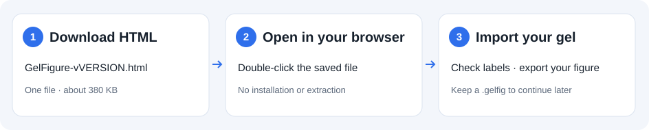

# Download one file and start making figures

[中文说明](getting-started.zh-CN.md) · [Back to the project](../README.md)

**On a computer, you need just one HTML file. No installation, ZIP extraction or GitHub account.**

## 1. Download

**[Download GelFigure-v0.6.4.html](https://github.com/poplarity/GelFigure/releases/download/v0.6.4/GelFigure-v0.6.4.html)** and save it to your Desktop or Downloads folder.

This is the complete tool, about 380 KB. The interface, styles and image-processing code are all inside the same file.

If you arrive at the [GitHub release page](https://github.com/poplarity/GelFigure/releases/latest):

1. Find **Assets** and expand it if needed.
2. Click **GelFigure-vVERSION.html**.
3. Wait for the download to finish, then find it in your computer's Downloads folder.

**Do not choose `Source code (zip)`, `Source code (tar.gz)` or the repository's `index.html`.** Those are source files, rather than the complete single-file version.

## 2. Open in your browser

- **Windows:** double-click the downloaded file. If it opens in a text or code editor, right-click → **Open with** → Edge, Chrome or Firefox.
- **Mac:** double-click the downloaded file. If a browser does not open, right-click → **Open With** → Safari, Chrome or Firefox.

Click **Try the example** to explore the tool. For future sessions, open the same file again; no further download or internet connection is required.

## 3. Import and export

1. Click **Choose file** and select your `.tif`, `.tiff`, `.png` or `.jpg` gel image, or drag it into the window.
2. Check the **DNA/protein mode, crop, lanes and marker ladder**. You can correct automatic detection by hand.
3. Click the lane names on the figure to edit them. Add groups, arrows or region boxes if needed.
4. Click **Export PNG**, review any warnings, and save the image. Other formats are in the menu beside the export button.

## Save, update and share

**Save progress:** before closing, choose **File → Save project**. The `.gelfig` file contains your original image and annotations. Next time choose **File → Open project**. Your browser's “Save page” command does not save your figure-editing session.

**Update:** download the new HTML from Releases. Save your project in the old version first, then open it in the new version. Offline HTML files do not update themselves.

**Share:** send the `GelFigure-vVERSION.html` file to a colleague with “Save this to your computer and open it in your browser.” A messaging app's attachment preview may not run the tool.

**Phones and tablets:** use the [online version](https://poplarity.github.io/GelFigure/) in your browser. Opening local HTML files varies between mobile operating systems, file managers and messaging apps.

## If something looks wrong

| What you see | What to do |
|---|---|
| Plain text and buttons without the normal layout | Styles have not applied. Check that you downloaded `GelFigure-vVERSION.html`; for the online version, hard-refresh first. The single-file version needs no separate CSS or JS folders. |
| `index.html` inside a ZIP does not work | Download the single HTML instead. To use the ZIP, **extract everything first**; do not open it inside the archive or extract only `index.html`. |
| A text editor, source code or attachment preview opens | Save the file to your computer, then right-click → Open with → choose your browser. |
| You cannot find the downloaded file | Check your browser's download list and your computer's Downloads folder. Make sure the download has finished. |
| The website or download is slow | Once downloaded, the HTML works offline on every subsequent use. A colleague can also send you their downloaded HTML file. |
| Your last figure is not restored after a reload | Drafts depend on browser storage permissions. Save a `.gelfig` project explicitly and reopen it. |

Hard-refresh the website with **Ctrl+Shift+R** on Windows or **Command+Shift+R** on Mac. For a bug report, include your browser version, whether you opened a URL or a local file, the file name, and a screenshot. You do not need to publish your experimental image.
